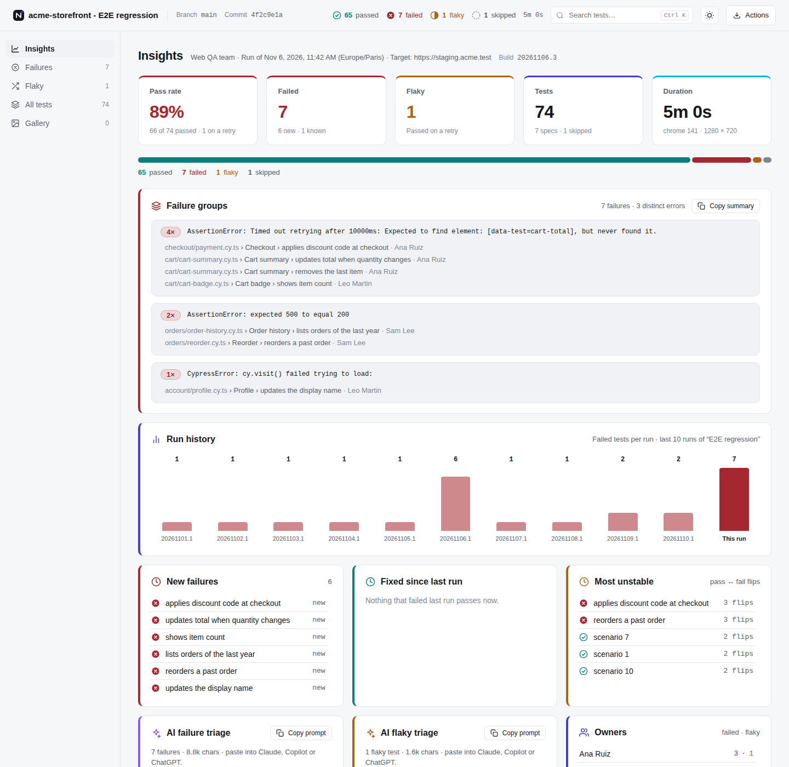

# Cypress Neo Reporter

One HTML report for Cypress runs: failures grouped by cause, history from your CI and the evidence behind every failed test.

[](https://www.npmjs.com/package/cypress-neo-reporter)
[](LICENSE)
[](https://github.com/mcello23/cypress-neo-reporter/actions/workflows/ci.yml)


<picture>
  <source media="(prefers-color-scheme: dark)" srcset="docs/assets/report-dark.png">
  
</picture>

## Features

- **Failure groups.** Tests that broke for the same reason sit together, so one fix closes the group.
- **Run history.** Each failure is marked new, known or fixed against your last 10 runs, read from Azure DevOps or from a history file you keep between runs.
- **Evidence per test.** Steps, screenshots, a video clip of the failed test, failed requests and console errors.
- **Tags.** `@smoke` in a test title becomes a tag, with its own panel and a `tag:smoke` search.
- **AI triage prompts.** Copy one prompt for the whole run or for one test and paste it into any assistant. No API keys.
- **Quality gate and chat.** `neo-reporter gate` fails the pipeline on new failures or a low pass rate. `neo-reporter notify` posts the result to Slack or Microsoft Teams.
- **Secrets masked.** Tokens, cookies and passwords in URLs are replaced with `[redacted]` in every output.
- **CI aware.** Build links on Azure DevOps, GitHub Actions and GitLab CI, and a summary on the Azure DevOps run page and the GitHub job summary.
- **Your team's name.** Put your team in the header and the page title with `teamName`, hide it with `showTeamName: false`.
- **Your time zone.** Every time in the report uses the zone you set with `timeZone`, not the CI machine's.
- **Light and dark.** Follows the reader's system by default, with a switch in the header.
- **One file.** No server and no external assets. Open it offline, attach it to a ticket, keep it as a build artifact. Parallel runs merge into one.

## Requirements

- Cypress 15 or 16
- Node.js 20 or later

Video clips use the ffmpeg build that ships with Cypress, so there is nothing else to install. The package has no runtime dependencies.

## Install

```bash
npm install --save-dev cypress-neo-reporter
```

## Set up

Register the plugin in `setupNodeEvents` and return what it returns:

```ts
import { defineConfig } from 'cypress';
import { neoReporter } from 'cypress-neo-reporter/plugin';

export default defineConfig({
  video: true,
  e2e: {
    setupNodeEvents(on, config) {
      return neoReporter(on, config, {
        projectName: 'acme-storefront',
        reportName: 'E2E regression',
        teamName: 'Web QA team',
        timeZone: 'Europe/Paris',
      });
    },
  },
});
```

`neoReporter` returns the config with a flag the support file looks for, so `setupNodeEvents` must return it.

Then import the support file in `cypress/support/e2e.ts`:

```ts
import 'cypress-neo-reporter/support';
```

The support file records steps, failed requests and console errors for each test. Without it the report still works, without the step list. Without the plugin it records nothing and never fails a test, so a support file shared with another config is safe.

Run Cypress headless as usual (`npx cypress run`). The report is written when the run finishes.

## Output files

Files are written to `cypress/reports` and named after `reportName`, or `projectName` when there is no report name.

| File | What it is |
| --- | --- |
| `E2E-regression.html` | The report. One file, screenshots and clips inside. |
| `E2E-regression.<id>.json` | Every result as data, for your own dashboards and for `neo-reporter merge`. |
| `E2E-regression.junit.xml` | For any CI test tab: Azure DevOps, GitLab, Jenkins. |
| `E2E-regression.summary.md` | A short summary for pipeline pages and pull request comments. |

The `<id>` is 8 characters built from the browser, base URL, viewport and spec files, so machines that run different specs do not overwrite each other's JSON, and a re-run replaces its own file. A merged JSON is plain `E2E-regression.json`. The JSON carries `schemaVersion` and `reporterVersion`; build dashboards on that contract.

## Options

Every option is optional.

| Option | Default | What it does |
| --- | --- | --- |
| `projectName` | `package.json` name | Shown in the header. |
| `reportName` | none | Suite label next to the project name. Also the file name. |
| `teamName` | none | Your team's name, shown in the header and the page title. |
| `showTeamName` | `true` | Set to `false` to hide the team name and keep it in your config. |
| `timeZone` | the machine's zone | IANA name used for every time in the report, such as `America/New_York`. |
| `theme` | `'auto'` | `'light'`, `'dark'` or `'auto'` to follow the reader's system. Readers can still switch it. |
| `outputDir` | `'cypress/reports'` | Where the files are written. |
| `outputs` | all four | Any of `'html'`, `'json'`, `'junit'`, `'markdown'`. |
| `history` | Azure DevOps, when a token is set | Run history settings. `{ provider: 'file' }` keeps history in a file, `false` turns it off. |
| `reportUrl` | none (the run page on GitHub Actions) | Link the Markdown summary points to, such as your published pipeline artifact. |
| `redact` | on | Masks secrets in every output. Add your own `patterns`, or set `false` to turn it off. |
| `includeTestCode` | `true` | Set to `false` to leave test code out of every output. |
| `maxEmbedMb` | `150` | Cap on the screenshots and clips embedded in the report. |
| `assets` | `'inline'` | `'folder'` writes screenshots and clips to a folder next to the report instead. |
| `keepVideos` | `false` | Set to `true` to leave Cypress's own videos in place. |

A wrong value, such as an unknown output or time zone, stops the run with an error. An unknown option name prints a warning.

All options, the CLI and the environment variables are in [docs/options.md](docs/options.md).

## Logging steps

The support file adds three commands. Steps show in the Cypress command log and in the report, and the last steps before a failure go into the AI prompt.

```ts
it('applies a discount code', () => {
  cy.step('Open the cart with 2 items', 'VISIT');
  cy.visit('/cart');
  cy.step('Apply SPRING10', 'STEP');
  cy.get('[data-test=discount]').type('SPRING10{enter}');
  cy.step('Total shows the discount', 'CHECK');
  cy.get('[data-test=cart-total]').should('contain', '€90.00');
});
```

| Command | Use it for |
| --- | --- |
| `cy.step(message, phase?)` | One step. Phases: `VISIT`, `FIND`, `STEP`, `CHECK`, `INFO` (default). |
| `cy.addTestContext({ title, value })` | Extra data shown with the steps, such as the test user or an order ID. |
| `cy.businessGoal(goal, persona?)` | What the test proves, in plain words. Shown above the steps. The persona defaults to `Business User`. |

In the Cypress app, click the command log and press <kbd>Alt</kbd>+<kbd>S</kbd> to show only these steps.

## Tags

Words that start with `@` in `describe` and `it` titles become tags:

```ts
describe('Checkout @smoke', () => {
  it('pays by card @payments', () => {
    // ...
  });
});
```

The report gets a Tags panel with passed · failed · flaky per tag, the search takes `tag:smoke`, and the JUnit file gets a `<property name="tag">` for each tag.

## Run history

On Azure Pipelines, history is read from past test runs. See [Azure DevOps](docs/azure-devops.md).

On any other CI, keep history in a file:

```ts
return neoReporter(on, config, { history: { provider: 'file' } });
```

Each run adds one line to `cypress/reports/neo-history.jsonl` and compares with the lines before it. CI agents usually start clean, so save that file between runs with your CI's cache. The [GitHub Actions](docs/github-actions.md) and [GitLab CI](docs/gitlab-ci.md) guides show how.

To compare two runs once, without history, pass `--baseline <earlier report.json>` to `neo-reporter merge`.

## Report size

The report is one file by default. Only the screenshots and clips of failed and flaky tests are embedded, failed tests first, up to `maxEmbedMb` (150 by default). The cap counts embedded data, which is about 4/3 of the size on disk. The run log says how many files were left out and how big each written file is.

With `assets: 'folder'`, screenshots and clips are copied to `E2E-regression.<id>-assets/` next to the report and the JSON keeps only their paths. Publish the whole folder. `neo-reporter merge` embeds them again from next to each JSON.

## Parallel runs

Keep the `json` output on each machine and collect the JSON files, in one folder or in one subfolder per machine. Subfolders are safest when two machines run the same specs in the same browser with different settings. Then merge them:

```bash
npx neo-reporter merge downloaded-reports --name "E2E regression"
```

The merged report gets HTML and Markdown by default. It counts every run it finds and warns when the same spec, browser and testing type turn up twice, for example from an artifact downloaded twice. When machines ran different browsers, spec cards show which one.

With file history, pass `--history-file cypress/reports/neo-history.jsonl` to `merge` and leave the file provider off on the machines. Run `npx neo-reporter merge --help` for every flag.

## Quality gate and notifications

Let the report decide whether the pipeline fails:

```bash
npx cypress run || true
npx neo-reporter gate cypress/reports/E2E-regression.*.json --fail-on new --min-pass-rate 95
```

`--fail-on new` fails only on tests that did not fail the last time they ran, new tests included, so it needs run history. `--fail-on failed` fails on any failure. List tests you already know are broken in a `quarantine.json`, and the gate does not count them. On parallel runs, pass the same flags to `merge`.

`neo-reporter notify` posts the counts, new failures and top failure groups to Slack or Microsoft Teams. Keep the webhook in a secret and pass it as `NEO_SLACK_WEBHOOK` or `NEO_TEAMS_WEBHOOK`. `merge` posts too when a webhook is set, so post from one place, once per pipeline.

The flags, the quarantine format and the exit codes are in [docs/options.md](docs/options.md#cli).

## CI integrations

| CI | Build links | Failure history | Pipeline summary |
| --- | --- | --- | --- |
| Azure DevOps | Supported | Supported | Supported |
| GitHub Actions | Supported | History file, cached | Job summary |
| GitLab CI | Supported | History file, cached | `summary.md` file, JUnit in the merge request |
| Any other CI | Branch and commit from git | History file | `summary.md` file |

JUnit XML is written on every CI, so the native test tab keeps working. Pipeline setup: [Azure DevOps](docs/azure-devops.md), [GitHub Actions](docs/github-actions.md), [GitLab CI](docs/gitlab-ci.md).

## What the report contains

The report holds what the run captured, so share it the way you share test logs:

- Error messages and stacks. A failed `cy.request` includes its request and response headers and bodies.
- The code of failed tests, and the steps, goals and test context you log.
- Failed requests (status 500 and up) and browser console errors.
- The target URL, branch, commit and spec owners (git author names).
- Screenshots and video of failed and flaky tests.

By default `redact` replaces `Authorization`, `Cookie` and `Set-Cookie` values, bearer tokens, JWTs and passwords in URLs with `[redacted]`, and drops the query string from request URLs. Screenshots and videos are never redacted. Details are in [docs/options.md](docs/options.md#redaction).

The HTML makes no network requests, and its Content-Security-Policy blocks them. Copying an AI prompt is different: what you paste goes to that assistant's provider.

## Known limitations

- Cypress keeps only one handler per `before:run`, `after:run` and `after:spec` event. If another plugin registers them after `neoReporter`, the report may not be written, and the run prints a warning that links here. Call the handlers from your own events instead:

  ```ts
  import { createNeoReporter } from 'cypress-neo-reporter/plugin';

  setupNodeEvents(on, config) {
    const neo = createNeoReporter(config, { reportName: 'E2E regression' });
    on('task', neo.tasks);
    on('before:run', details => {
      neo.beforeRun();
      otherPlugin.beforeRun(details);
    });
    on('after:spec', (spec, results) => {
      neo.afterSpec(spec, results);
      otherPlugin.afterSpec(spec, results);
    });
    on('after:run', async results => {
      await neo.afterRun(results);
      await otherPlugin.afterRun(results);
    });
    return config;
  },
  ```

  Or wrap `on` with [cypress-on-fix](https://github.com/bahmutov/cypress-on-fix) (`const on = require('cypress-on-fix')(cypressOn)`), which lets every plugin keep its handlers.
- Video clips need `video: true` and are only cut for failed or flaky tests. Videos of passing specs are deleted, and a failing spec's full video is replaced by its clips, so Cypress Cloud and CI artifact steps do not see them. Set `keepVideos: true` to keep Cypress's videos.
- Per-test clips need ffprobe, which ships with Cypress 15.16 and later. On older versions the failing spec's full video is embedded instead.
- Screenshots are matched to a test by Cypress's default file name. A screenshot saved under a custom name, such as `cy.screenshot('cart')`, is not attached.
- Failed requests are recorded from the browser's resource timing, which reports status codes in Chromium-based browsers only.
- Tags come from titles only. The `{ tags }` config of @cypress/grep is not read yet.
- Run history is not kept per browser.

## Troubleshooting

- **"Steps are not recorded" in the command log.** The plugin is not registered for this config, or `setupNodeEvents` does not return the config. Use `return neoReporter(on, config, options)`.
- **"Ignoring unknown option".** An option name is misspelled. The warning lists the names it knows.
- **Cypress fails to start or verify.** The shell sets `ELECTRON_RUN_AS_NODE=1`, as VS Code terminals can. Run `unset ELECTRON_RUN_AS_NODE` first, or use another terminal.
- **"Another plugin replaced neo-reporter's before:run handler".** A plugin registered run events after `neoReporter`. See [Known limitations](#known-limitations).
- **No run history.** Azure DevOps history needs a token (`SYSTEM_ACCESSTOKEN` in a pipeline, `AZURE_DEVOPS_PAT` on your machine). Without one, history is skipped without a message. With one, the run log says why history was skipped. The file provider needs an earlier run in the file, so keep the file between CI runs. History is only loaded when the `html` or `markdown` output is on.

## Contributing

Issues and pull requests are welcome. See [CONTRIBUTING.md](CONTRIBUTING.md).

```bash
npm install
npm test
npm run demo
```

`npm run demo` builds a sample report in `demo/` from the fixture in `test/fixtures`, so you can work on the report without a Cypress project.

## License

[MIT](LICENSE) © Marcelo Costa. Not affiliated with Cypress.io or Microsoft.
